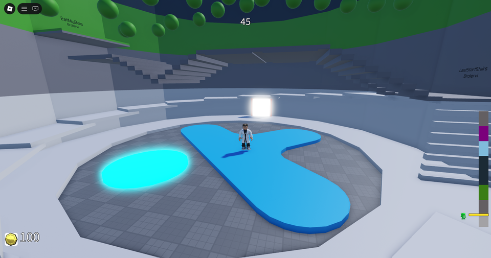
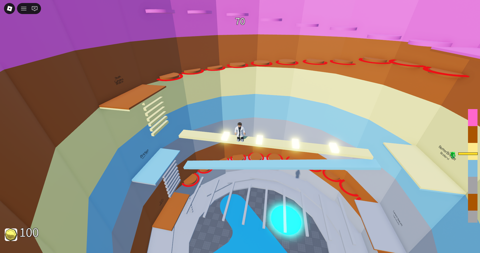

<div align="center">

# Tower of Hell Idea

**Roblox experience inspired by Tower of Hell. Climb a randomly generated tower before the timer runs out.**  
**Experiencia en Roblox inspirada en Tower of Hell. Escala una torre generada aleatoriamente antes de que se acabe el tiempo.**

[  ]( https://www.roblox.com/games/8320991483/Tower-of-Hell-Idea )

</div>

---

## Demo / Demostración

**Live / En vivo:** [ Play on Roblox ]( https://www.roblox.com/games/8320991483/Tower-of-Hell-Idea )

<!-- Add screenshots -->



## What it does / Qué hace

- Generates a tower by stacking random sections.  
  *Genera una torre apilando secciones aleatorias.*

- Players must reach the top before the timer reaches zero.  
  *Los jugadores deben llegar a la cima antes de que el tiempo se acabe.*

- Reaching the end awards points.  
  *Llegar al final otorga puntos.*

- When time runs out, everyone returns to the lobby and a new tower is generated.  
  *Cuando se acaba el tiempo, todos regresan al lobby y se genera una nueva torre.*

## Tech Stack / Tecnologías

- **Language / Lenguaje:** Luau
- **Engine:** Roblox
- **Project Sync:** Rojo 7.7.1
- **Toolchain Manager:** Rokit
- **Formatter:** StyLua
- **Linter:** Selene

## How to run it / Cómo correrlo

### Requirements / Requisitos

- Roblox Studio
- Rokit

### Steps / Pasos

```bash
git clone https://github.com/alanotonielgarciahernandez/alan-otoniel-garcia-hernandez-tower-of-hell-idea.git
cd alan-otoniel-garcia-hernandez-tower-of-hell-idea
rokit install
rojo plugin install
```

Restart Roblox Studio after installing the plugin.
Open the place in Studio and run:

```bash
rojo serve
```

Then connect the Rojo plugin in Studio.

### Technical decisions / Decisiones técnicas
- The project is managed with Rojo so the game logic stays as version-controlled Luau files.  
  *El proyecto se gestiona con Rojo para que la lógica del juego permanezca como archivos Luau versionados.*

- Tower generation, timer, and points systems are separated into modules.  
  *La generación de la torre, el temporizador y el sistema de puntos están separados en módulos.*

- This is a practice project based on the original Tower of Hell mechanics.
  *Es un proyecto de práctica basado en las mecánicas originales de Tower of Hell.*

### Status / Estado
Practice project. The published version is available on Roblox.  
*Proyecto de práctica. La versión publicada está disponible en Roblox.*

### License / Licencia
MIT
